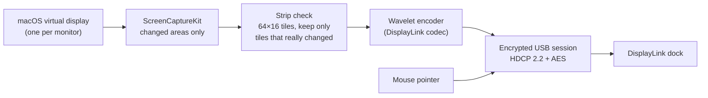

  

<h1 align="center">LinkLite</h1>

  <strong>The lightweight DisplayLink alternative</strong> 
   
  Drive the monitors on your DisplayLink dock without DisplayLink Manager. 
  One small macOS menu-bar app. No login-window agent, no telemetry. Automatic updates.

  
  
  
  
  

  Signed and notarized releases · Open source · Built on the <a href="https://lwn.net/Articles/1090989/">Vino</a> DisplayLink protocol research

  <picture>
    <source media="(prefers-color-scheme: dark)" srcset="docs/assets/benchmark-dark.png">
    
  </picture>

  74% less memory in the historical LinkLite 0.2.0 benchmark with two 4K monitors—not re-measured for later releases. <a href="docs/BENCHMARK.md">Full benchmark, method, and CPU tradeoff →</a>

---

**LinkLite** is a native macOS menu-bar app that talks to DisplayLink USB docks directly. For each monitor on the dock it creates a macOS display, sends only the parts of the screen that change, and lets the dock draw your mouse pointer. Tested on a Humanscale M/Connect 2 driving two 4K monitors at 60 Hz.

**Beta software.** v0.3.15 is the latest public release; that does not establish 1.0 readiness. The v0.3.7 refactor still needs live-hardware validation of two-monitor rendering, repeated unplug/replug and sleep/wake, the receive-queue high-water mark, and an eight-hour memory run. See the [engineering gates](docs/DEVELOPMENT.md#engineering-hardening--2026-11-04-v037).

## Install

1. Download `LinkLite-<version>.dmg` from [Releases](https://github.com/matthewrball/linklite/releases), open it, and drag **LinkLite** into Applications.
2. Quit DisplayLink Manager (menu-bar icon › Quit). Only one app can drive the dock at a time.
3. Open LinkLite and allow **Screen & System Audio Recording** when asked ([why?](#why-does-linklite-need-screen-recording)), then quit and reopen it from its menu-bar icon.
4. Your monitors light up within a few seconds. Turn on **Open at Login** from the menu-bar icon.

Requires macOS 14 Sonoma or later on Apple silicon, and a USB 3 (5 Gbps) link to the dock. From then on LinkLite keeps itself up to date.

## Why LinkLite

- **Light on your Mac.** A native Swift app and Rust display engine, without a bundled browser runtime. The [real-dock benchmark](docs/BENCHMARK.md) records the memory, GPU, and CPU tradeoffs.
- **A clean picture.** Native 4K60 on the tested dock, sharp HiDPI "looks like" resolutions, and changed areas re-sent to every dock frame buffer once the screen settles.
- **The dock draws the pointer.** Moving the mouse sends a few bytes of position data instead of re-encoding the screen around it.
- **Nothing extra running.** No kernel extension, no login-window agent, no always-running driver helper.
- **Recovers on its own.** Monitors switched on after LinkLite starts are picked up, and displays recover after a dock reset or cable reconnection.
- **Stays up to date.** New releases download in the background; LinkLite asks before restarting to install them.
- **Private by construction.** No analytics or account. Network traffic is limited to update checks and downloads from GitHub. See [PRIVACY.md](PRIVACY.md).

## Latest optimizations

**Shipped in v0.3.7.** This refactor cuts avoidable work without changing the display pipeline or encoded output:

- The closed menu no longer keeps its status animation running.
- Capture, cursor, and strip-candidate buffers are reused; frame packing avoids duplicate copies.
- USB replies are bounded, with hardened descriptor parsing and transfer teardown.

  <picture>
    <source media="(prefers-color-scheme: dark)" srcset="docs/assets/optimizations-dark.png">
    
  </picture>

These are component checks, not new whole-app memory, display-frame-rate, or live-dock results. [Measurements and method](docs/BENCHMARK.md#hardware-free-optimization-checks--2026-11-04) · [Security boundaries](SECURITY.md#trust-boundaries)

## The real-dock benchmark

**Historical baseline, measured November 3, 2026—not a rerun after the new optimizations.** LinkLite 0.2.0 pre-release versus DisplayLink Manager 16.1.25: two 4K monitors, the same Apple M5 Pro Mac on macOS 26.6, and the same workload.

| | LinkLite | DisplayLink Manager |
|---|---|---|
| CPU, live desktop | 55% | **2%** |
| CPU, 60 fps motion | 338% | **20%** |

The tradeoff: DisplayLink Manager compresses video on the GPU; LinkLite compresses it on the CPU. In this benchmark LinkLite used less memory and less whole-system GPU under motion, but more CPU. These results have not been extrapolated to v0.3.7 or later. Method, per-run numbers, and raw data: [docs/BENCHMARK.md](docs/BENCHMARK.md).

## Compatibility

| | Status |
|---|---|
| Humanscale M/Connect 2 (DL-6xxx "Ridge") | Historically tested with two 4K60 monitors; v0.3.7+ hardware requalification pending |
| Dell D6000 and other DL-6xxx docks | Same protocol family; not individually certified |
| Targus DOCK310 (DL-6xxx "Ridge", USB `17e9:6024`) | HDMI output verified at 2560x1440@60 and 1920x1080@60; DisplayPort output untested |
| DL-3xxx ("Ella") and DL-7400 ("Navarro") docks | Recognised by the protocol core; untested on macOS |
| Macs | Apple silicon, macOS 14 or later; Intel not supported |
| Protected (HDCP) video playback | Not supported |

macOS 14 is the minimum deployment target, not evidence of hardware or GUI testing on every supported macOS release. The recorded real-dock benchmark used macOS 26.6. See the [qualification matrix](docs/DEVELOPMENT.md#pre-10-qualification-matrix) for pending hardware and fresh-profile permission checks.

Tried LinkLite with another dock? Please [file a dock report](https://github.com/matthewrball/linklite/issues/new?template=dock_report.yml), whether it worked or not.

## How it works

The dock speaks DisplayLink's proprietary, encrypted protocol. LinkLite's engine (Rust) builds on the open-source [Vino](https://lwn.net/Articles/1090989/) work, which documented that protocol for Linux, and adds the macOS side (Swift): virtual displays, capture, pointer tracking, and the menu-bar app. Local changes to the vendored protocol core are listed in [`vendor/vino/UPSTREAM.md`](vendor/vino/UPSTREAM.md).

## FAQ

### Why does LinkLite need Screen Recording?

macOS has no public way for an app to provide a display: Apple offers no display driver framework, and display kernel extensions no longer work on Apple silicon. So every USB display product, DisplayLink Manager included, creates a virtual display and reads its pixels back with ScreenCaptureKit, which macOS puts behind the Screen Recording permission. LinkLite captures only the virtual displays it creates for your dock, never your built-in screen, and the pixels go nowhere but the USB dock.

### Is this made by DisplayLink or Synaptics?

No. LinkLite is an independent open-source project and is not affiliated with or endorsed by Synaptics or DisplayLink. DisplayLink is a trademark of Synaptics Incorporated, used here only to describe compatibility.

## Privacy and security

No analytics or telemetry. Update checks and downloads go to GitHub; your display pixels go to the USB dock, not a backend. Use a dock you trust to receive those pixels. Details in [PRIVACY.md](PRIVACY.md) and [SECURITY.md](SECURITY.md). Report vulnerabilities privately as described in the security policy.

## Credits

The DisplayLink protocol, HDCP session, and video codec come from [Vino](https://lwn.net/Articles/1090989/) by Mike Lothian and contributors ([source](https://github.com/cameron1729/Vino)), used under GPL-2.0-or-later.

## License

[GPL-2.0-or-later](LICENSE) © 2026 Matthew Ball.
